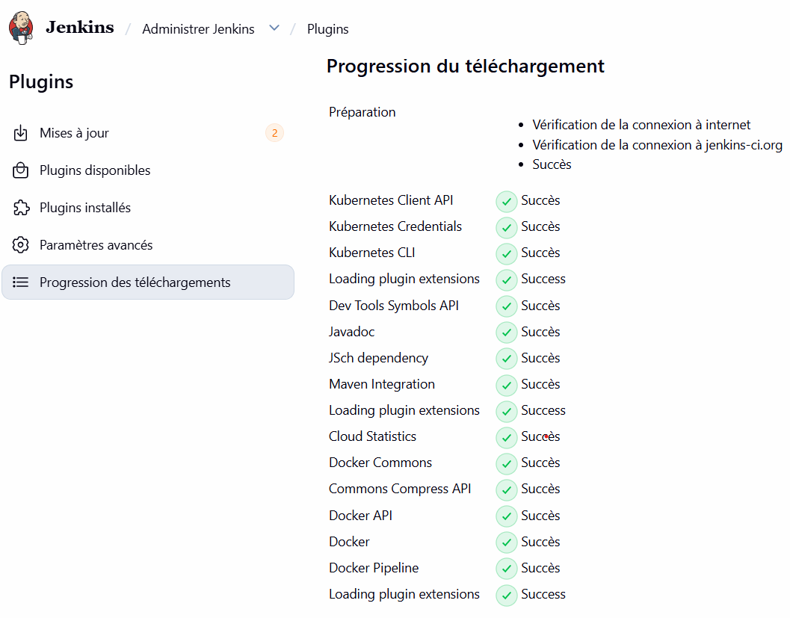
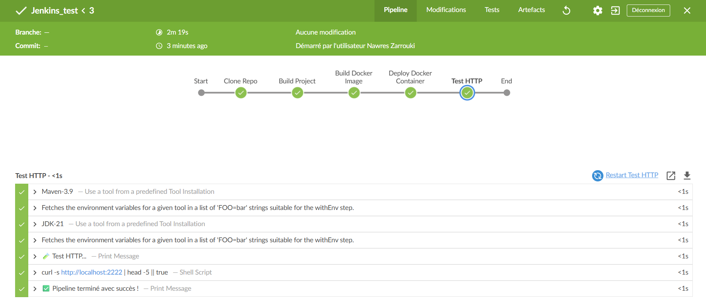
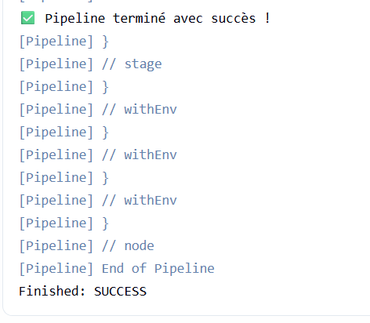
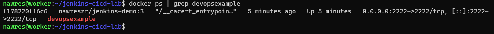
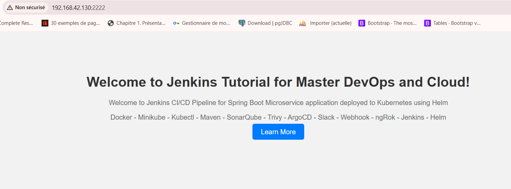

# 🚀 Lab 2 — Pipeline CI/CD avec Jenkins

Deuxième laboratoire DevSecOps : mise en place d'un **pipeline CI/CD complet** avec **Jenkins** pour automatiser le build, la conteneurisation et le déploiement d'une application **Spring Boot**.

**Auteur** : Nawres Zarrouki

---

## 🎯 Objectifs

- **Forker** le projet `Jenkins-Demo` sur GitHub
- **Installer** les plugins Jenkins nécessaires
- **Configurer** JDK-21 et Maven-3.9 dans Jenkins
- **Créer un Jenkinsfile** (Pipeline déclaratif)
- **Automatiser** : Clone → Build Maven → Build Docker → Deploy → Test HTTP
- **Valider** le `Finished: SUCCESS`

---

## 🛠️ Stack technique

| Composant | Version |
|---|---|
| Jenkins | LTS |
| Java | OpenJDK 21 |
| Maven | 3.9 |
| Docker | 29.9.0 |
| Git / GitHub | 2.53.0 |
| OS | Ubuntu 26.04 Server |

---

## 📦 Étapes réalisées

### Étape 1 — Fork du projet Jenkins-Demo

Fork du dépôt original `https://github.com/wahid007/Jenkins-Demo` vers mon compte GitHub :

🔗 **https://github.com/nawreszr/Jenkins-Demo**

### Étape 2 — Installation des plugins Jenkins

**Administrer Jenkins** → **Gestion des plug-ins** → onglet **Disponibles**

Plugins installés :

| Plugin | Version | Rôle |
|---|---|---|
| **Kubernetes CLI** | 1.10.3 | Piloter kubectl depuis Jenkins |
| **Maven Integration** | 3.18 | Intégration Maven native |
| **Docker** | 1.2.9 | Commandes Docker |
| **Docker Pipeline** | 1.28 | Support Docker dans les pipelines |

**Capture de l'installation** :



### Étape 3 — Configuration JDK + Maven

**Administrer Jenkins** → **Configuration globale des outils** :

**JDK** :
- Nom : `JDK-21`
- Chemin JAVA_HOME : `/usr/lib/jvm/java-21-openjdk-amd64`

**Maven** :
- Nom : `Maven-3.9`
- Installation automatique depuis Apache
- Version : `3.9.9`

### Étape 4 — Création du Jenkinsfile

Fichier `Jenkinsfile` ajouté à la racine du fork GitHub :

```groovy
pipeline {
    agent any

    tools {
        maven 'Maven-3.9'
        jdk 'JDK-21'
    }

    environment {
        DOCKER_IMAGE_TAG = "nawreszr/jenkins-demo:${env.BUILD_NUMBER}"
    }

    stages {
        stage('Clone Repo') {
            steps {
                echo '📥 Clone du fork GitHub...'
                git branch: 'main', url: 'https://github.com/nawreszr/Jenkins-Demo.git'
            }
        }

        stage('Build Project') {
            steps {
                echo '🏗️ Build Maven...'
                sh 'mvn clean package -DskipTests'
                sh 'ls -lh target/*.jar'
            }
        }

        stage('Build Docker Image') {
            steps {
                echo '🐳 Build de l\'image Docker...'
                sh '''
                    cat > Dockerfile << 'EOF'
FROM eclipse-temurin:17-jre
WORKDIR /app
COPY target/devOpsDemo-0.0.1-SNAPSHOT.jar app.jar
EXPOSE 2222
CMD ["java", "-jar", "app.jar"]
EOF
                    docker build -t ${DOCKER_IMAGE_TAG} .
                '''
            }
        }

        stage('Deploy Docker Container') {
            steps {
                echo '🚀 Démarrage du conteneur...'
                sh '''
                    docker rm -f devopsexample || true
                    docker run --name devopsexample -d -p 2222:2222 ${DOCKER_IMAGE_TAG}
                    sleep 5
                    docker ps | grep devopsexample
                '''
            }
        }

        stage('Test HTTP') {
            steps {
                echo '🧪 Test HTTP...'
                sh 'curl -s http://localhost:2222 | head -5 || true'
            }
        }
    }

    post {
        success {
            echo '✅ Pipeline terminé avec succès !'
        }
        failure {
            echo '❌ Pipeline échoué.'
        }
    }
}

---

## 🚀 Résultat du pipeline

### Stage View — Tous les stages en SUCCESS



### Console Output — Finished: SUCCESS



---

## ✅ Vérification du déploiement

### Conteneur Docker en cours d'exécution



### Application accessible dans le navigateur



**URL de test** : `http://192.168.42.130:2222`

---

## 🎯 Conclusion

Le pipeline Jenkins a exécuté avec succès les 5 étapes :
1. ✅ Clone Repo
2. ✅ Build Maven
3. ✅ Build Docker Image
4. ✅ Deploy Container
5. ✅ Test HTTP

**Résultat final : `Finished: SUCCESS`** 🎉

---

## 👤 Auteur

**Nawres Zarrouki** — Étudiant DevSecOps

- 🔗 GitHub : [@nawreszr](https://github.com/nawreszr)
- 🐳 Docker Hub : [@nawreszr](https://hub.docker.com/u/nawreszr)

